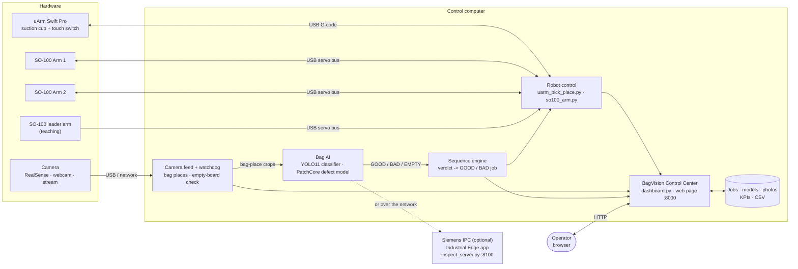
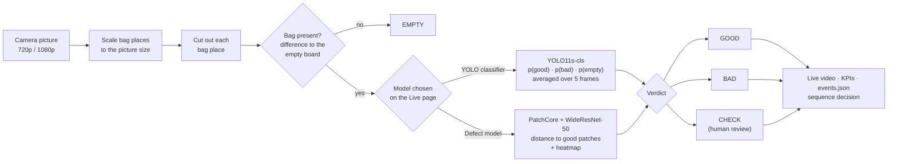
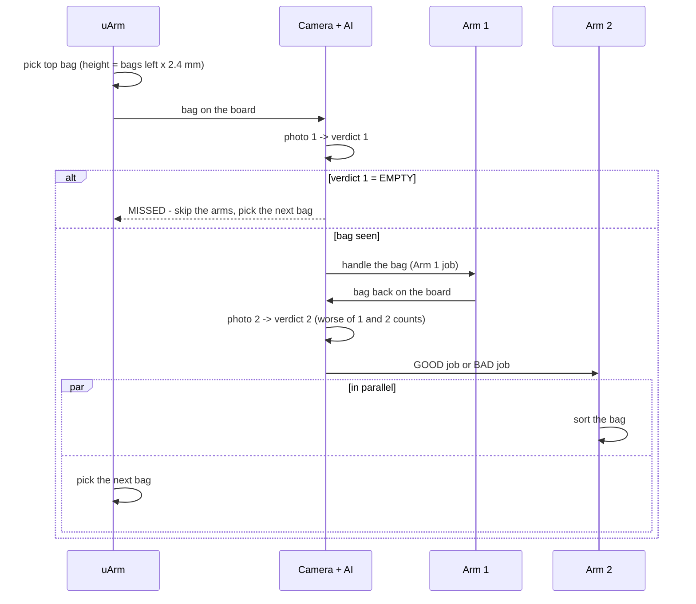

# Smart Bag Vision

A paper-bag handling cell that **picks, inspects and sorts** bags without a person at the line:

- A **uArm Swift Pro** with a suction cup picks bags one by one from a stack.
- An **Intel RealSense D435** camera looks at every bag. **AI** decides GOOD / BAD / EMPTY.
- **SO-100 robot arms** handle the bag and sort it into the GOOD or BAD place.
- Everything is run from one web page, the **BagVision Control Center**. It shows live video, KPIs, robot control, teaching, dataset collection and model training.

---

## Contents

1. [Pipeline block diagram](#pipeline-block-diagram)
1. [How the cell works](#how-the-cell-works)
2. [Hardware](#hardware)
3. [Setup](#setup)
4. [Dashboard](#dashboard)
5. [The two AI models](#the-two-ai-models)
6. [Teaching the robots](#teaching-the-robots)
7. [The production sequence](#the-production-sequence)
8. [Command-line tools](#command-line-tools)
9. [AI on a Siemens Industrial Edge IPC](#ai-on-a-siemens-industrial-edge-ipc)
10. [Dashboard HTTP API](#dashboard-http-api)
11. [Safety features](#safety-features)
12. [Repository layout](#repository-layout)
13. [Troubleshooting](#troubleshooting)

---

## Pipeline block diagram

**System overview:** which part talks to which.



**Inspection pipeline:** what happens to every camera picture.



**Production cycle:** one bag, from the stack to sorted.



---

## How the cell works

One cycle:

| Step | Who | What happens |
|---|---|---|
| 1 | **uArm** | Takes the top bag from the stack with its suction cup. It knows how many bags are left and lowers its pick height by one bag (2.4 mm) each time. Optionally it feels for the stack top with the cup's touch switch. Then it places the bag on the inspection board. |
| 2 | **Camera** | Photo. AI result: GOOD / BAD / EMPTY. If EMPTY (the pick failed), the arms are skipped and the cycle counts as **MISSED**. |
| 3 | **Arm 1** | Replays its taught job, e.g. flips or moves the bag. |
| 4 | **Camera** | Second photo. The **worse** of the two results counts, so damage from handling is caught too. |
| 5 | **Arm 2** | Runs its **GOOD job** or its **BAD job**, depending on the camera. |

While Arm 2 sorts, the uArm already picks the next bag. On the prototype one cycle takes about 92 s at deliberately slow, safe robot speeds.

---

## Hardware

| Device | Connection | Notes |
|---|---|---|
| **uArm Swift Pro** (suction) | USB, Arduino Mega 2560 (VID:PID `2341:0042`), 115200 baud, uArm G-code | Found automatically. The cup has a touch switch (`P2233`). |
| **SO-100 arms** | USB servo-bus adapter (CH343, `1a86:55d3`), 1 Mbit/s, Feetech STS3215 servos with IDs 1–6 | IDs: 1 shoulder pan, 2 shoulder lift, 3 elbow, 4 wrist flex, 5 wrist roll, 6 gripper |
| **SO-100 leader arm** (optional) | Same adapter type | Moved by hand; the follower copies it while you teach |
| **Camera** | **Intel RealSense D435** (USB 3; USB 2 works at 1280×720), **any webcam** (`/dev/videoN`), or a **stream / video** (`rtsp://…`, `http://…`, a video file) | Chosen on the Live page; colour only, looking straight down at the board |
| **Siemens SIMATIC IPC** (optional) | Network | Runs the AI as an Industrial Edge app |

**Arms in this repository** (`so100_settings.json`, recognised by the USB adapter's serial number):

| Name | Adapter serial | Motors | Power supply |
|---|---|---|---|
| `1` (Arm 1) | `5B14030143` | 12 V STS3215 | 12 V |
| `2` (Arm 2) | `5B14113529` | 12 V STS3215 | 12 V |
| `leader` | `5B14030142` | 7.4 V STS3215 | 5 V |

**Arms used only on one machine** stay out of git: list them in `robots.local.json` (`[{"key": "arm3", "title": "SO-100 Arm 3", "arm": "3"}]`, adds them to the dashboard) and keep their settings in `so100_settings.local.json`. Both files are ignored by git.

The 7.4 V and 12 V servos look the same and report the same model number. The voltage limit stored in each servo tells them apart, and the software refuses to switch motors on above that limit.

---

## Setup

Tested on **Ubuntu** with **Python 3.12** and an **NVIDIA GPU** (RTX 4060). A CPU works, but the defect model is slower.

```bash
git clone https://github.com/tejavadlamudi03/smart_bag_vision.git
cd smart_bag_vision
pip install -r requirements.txt
sudo usermod -aG dialout $USER        # access to the robot USB ports - log out and in once
```

The defect model downloads its WideResNet-50 weights from PyTorch once, on first use.

---

## Dashboard

```bash
python3 dashboard.py                  # http://localhost:8000   (--port to change)
```

All robots and the camera connect automatically. A device plugged in later is connected with the **Connect** button on its robot card. The camera reconnects by itself.

**Choosing the camera:** use the **Camera** list under the live video on the Live page.
- It shows the RealSense (if connected) and every webcam found, for example `HP Wide Vision HD Camera (/dev/video0)`.
- **Stream / video address…** takes an `rtsp://`, `http://` or video-file address.
- **↻** searches again after you plug a camera in.
- The choice is remembered (`camera.json`). Webcams open at up to 1920×1080.

| Page | What you can do |
|---|---|
| **Live** | Live video with the result per bag place (GOOD / BAD / EMPTY with confidence). Heatmap of where the defect is (defect model). **Model switch: YOLO classifier / Defect model.** BAD threshold, snapshot, KPIs. |
| **Production** | Totals, defect rate, yield, uncertain bags, escapes, ppm, bags per hour, trend chart, review queue (confirm or correct the AI), CSV export, "New shift" reset. |
| **Robots** | One card per robot: connect, choose a job (with its name), runs and speed, **Run**, home. **✎ Rename job.** uArm: bag count in the stack, touch-down pick. **Sequence:** cycles, jobs per robot, GOOD and BAD job for Arm 2, **▶ New sequence** / **⏯ Continue**. Live status bar (which robot works, which is next, the bag's verdict) and cycle history. |
| **Teach** | Teach a job by hand (the arm goes limp) or with the **leader arm**. Grab/release, save or cancel. uArm: "bags in the stack now" for stack picking. |
| **Dataset & AI** | Mark bag places on the video, take the empty-board picture, capture GOOD / BAD / EMPTY photos (single or automatic), train the YOLO classifier, set up **bag types** for the defect model, and choose **where the AI runs** (this computer or the IPC). |

**Bag places** are rectangles on the camera picture; each one is inspected separately. When the camera starts at another resolution (for example on a USB 2 port), the places and the empty-board picture are rescaled automatically.

---

## The two AI models

| | **YOLO classifier** | **Defect model** |
|---|---|---|
| **AI model** | **YOLO11s-cls** (Ultralytics), fine-tuned, image size 384 px | **PatchCore** anomaly detection on a **WideResNet-50** (ImageNet, layers 2 + 3) |
| **Learns from** | Labelled photos: 303 good, 87 bad, 235 empty | **Good bags only**; keeps a memory bank of about 20,000 good image patches |
| **Decides by** | Probabilities good / bad / empty | Distance of each part of the image to the nearest good patch; above the limit = BAD, just below = CHECK |
| **Unseen defect types** | Can miss them | Catches them |
| **Shows where** | No | Yes, a heatmap |
| **New bag design** | New good and bad photos, then retrain (a few minutes on the GPU) | Record one good bag for 20 s front and 20 s back, then **Build & use** |
| **Weak point** | Unsure on unusual but harmless things | Sensitive to anything new in the picture (moved camera, background, hands) |
| **Files** | `bag_models/best.pt`; older ones in `bag_models/history/` | `bag_models/anomaly.pt` (brown bags); bag types in `bag_models/profiles/<name>/` |

**Measured on the prototype** (small test sets):
- **Defect model:** caught 84 of 87 defective bags and wrongly flagged 2 of 98 good ones. The bag type was set up from two 20 s recordings.
- **Speed:** about 0.4 s per picture on a plain CPU in the edge container, and about 0.09 s on the laptop GPU.

Training never deletes a model: the previous `best.pt` is kept in `bag_models/history/`. New bag types are added next to the existing ones and don't replace them.

---

## Teaching the robots

Teaching records the whole path the arm moves through, not just single points. Replay repeats it at the taught speed, or faster or slower with **Speed**.

**In the dashboard (Teach page):**
1. Choose the robot, a job number and **Teach with**:
   - **hand**: the motors go limp and you move the arm;
   - **leader arm**: the follower copies the leader live, and its own path is recorded.
2. **Release motors** (or **Start following the leader**), move the arm to the start of the job, then **Start recording**.
3. Move through the job. Use **Grab** / **Release** for the suction cup or gripper.
4. **Save**. The motors lock again.

**uArm stack picking:** teach the job on top of a full stack and enter how many bags are in it. Each later pick goes one bag (2.4 mm) lower. The count is saved, so the uArm carries on correctly after a stop or restart.

**Converting jobs between SO-100 arms:** `python3 so100_arm.py --arm 2 copy-jobs --from 1` maps every joint through both arms' mechanical end stops.

---

## The production sequence

From the dashboard (Robots page), or without it:

```bash
python3 run_sequence.py --runs 10           # 10 cycles
python3 run_sequence.py --check             # check robots, jobs and camera - nothing moves
```

- **New sequence** starts at cycle 1 with a refilled stack (enter the bag count) and fresh KPIs.
- **Continue** carries on at the next cycle with the same stack height and counts. It works after a stop, an E-STOP or a restart, because progress is saved in `captures/last_sequence.json`.
- Photos of every cycle are saved in `captures/sequence_<date>_<time>/`.

---

## Command-line tools

| File | Commands |
|---|---|
| `uarm_pick_place.py` | `info`, `move X Y Z`, `pump on/off`, `home`, `learn N`, `replay N [--count --step --taken --speed]`, `jobs` |
| `so100_arm.py` | `--arm NAME` then: `info`, `learn N [--leader]`, `replay N [--count --speed]`, `jobs`, `park`, `free`, `set-rest`, `name NEW`, `copy-jobs --from NAME`, `gripper open/close/0-100`, `calibrate`, `where`, `move X Y Z`; also `leader-calibrate` |
| `run_sequence.py` | The production sequence without the dashboard |
| `bag_inspect.py` | YOLO classifier: `[--camera realsense / 0 / rtsp://...]` then `capture`, `train [--epochs --model]`, `inspect [--threshold]`, `check FOLDER` |
| `anomaly.py` | Defect model: `build` (from the good photos), `test IMAGE...` (score and heatmap) |
| `enroll.py` | Bag-type set-up, used by the dashboard |
| `inspect_server.py` | AI as a network service: `--port 8100 --token SECRET` |
| `ai_client.py` | Dashboard side of the AI service: sends pictures in the background, keeps models in sync, falls back to local models |
| `realsense_view.py` | Plain camera viewer |
| `capture_dataset.py` | Older photo capture tool |
| `so100_sim_view.py` | Renders a simulation video of the SO-100 (`so100_sim.mp4`) |

---

## AI on a Siemens Industrial Edge IPC

The robots and camera stay on the laptop; only the AI runs on the IPC.

1. Build the edge app (needs Docker):
   ```bash
   edge/build.sh                    # CPU version  -> edge/bagvision-ai_1.0.0.tar
   TORCH=cu130 edge/build.sh        # NVIDIA GPU version
   ```
2. In the **Industrial Edge App Publisher**, create an app, import `edge/docker-compose.yml` (compose 2.4, port 8100) and load the `.tar` image. Set your own `AI_TOKEN`, then publish.
3. In **Industrial Edge Management**, install the app on the device.
4. In the dashboard, go to **Dataset & AI → Where the AI runs**, enter `http://<ipc-address>:8100` and the token, and press **Use IPC**.
   - The laptop copies its current models to the IPC automatically.
   - If the IPC can't be reached, the laptop's own models take over until it's back.

`edge/full_app/` holds an alternative package that runs the whole system on an IPC with USB access.

---

## Dashboard HTTP API

The web page uses these routes; other programs can use them too.

| Method | Route | Purpose |
|---|---|---|
| GET | `/api/state` | Everything: vision, KPIs, robots, sequence, teaching, dataset, training, alarms |
| GET | `/video` | MJPEG live video with results |
| GET | `/raw.jpg` | Current camera picture |
| GET | `/export.csv` | Inspection results |
| POST | `/api/estop`, `/api/stop` | Stop all robots / one robot (`{"robot": "arm1"}`) |
| POST | `/api/connect`, `/api/home`, `/api/run` | Connect, home, run a job (`{"robot", "job", "count", "speed"}`) |
| POST | `/api/job/rename` | Name a job (`{"robot", "job", "name"}`) |
| POST | `/api/uarm/bags`, `/api/uarm/touch` | Bags in the stack; touch-down pick on or off |
| POST | `/api/sequence/start`, `/api/sequence/stop` | `{"mode": "new" or "continue", "cycles", "ujob", "a1job", "a2job", "a2bad", "bags"}` |
| POST | `/api/teach/start`, `/record`, `/event`, `/finish` | Teaching (`"leader": true` for the leader arm) |
| POST | `/api/detector` | `{"mode": "classifier" or "anomaly"}` |
| POST | `/api/threshold`, `/api/snapshot`, `/api/kpi/reset`, `/api/review` | Live and production |
| POST | `/api/dataset/...`, `/api/train` | Photo capture, bag places, empty board, training |
| POST | `/api/enroll/...`, `/api/profile/use` | Bag types |
| POST | `/api/ai` | Where the AI runs (`{"url", "token"}`; empty url = this computer) |
| POST | `/api/camera/list` | Cameras found: `{"cameras": [{"id", "name"}], "current"}` |
| POST | `/api/camera` | Use a camera: `{"source": "realsense"}`, a webcam number (`"0"`) or a stream / video address |

---

## Safety features

- **E-STOP** button on every dashboard page. It stops all robots and switches the uArm pump off.
- **Motor voltage guard:** SO-100 motors aren't switched on when the supply is above the servos' voltage limit (7.4 V motors on 12 V).
- **No jump on power-up:** SO-100 goal positions are set to the current position before torque is switched on.
- **Leader teaching:** the follower moves slowly to the leader's pose first, and can never run more than about 3.5° ahead of where it is.
- **uArm:** checks reach before each move, approaches the stack vertically, travels above the stack, and never presses more than 3 mm into it.
- **Camera watchdog:** if pictures stop for 8 s (cable pulled or re-plugged), the camera is reopened automatically.
- **One program per port:** each robot's USB port is used by one thread at a time, and a running sequence locks the robots it uses.

---

## Repository layout

```
dashboard.py, dashboard_ui.html   BagVision Control Center (server + web page)
uarm_pick_place.py                uArm control, teaching, replay, stack picking
so100_arm.py                      SO-100 control, teaching (hand / leader), replay, kinematics
run_sequence.py                   production sequence (command line)
bag_inspect.py                    YOLO classifier: camera, bag places, capture, train, inspect
anomaly.py, enroll.py             defect model, bag types
inspect_server.py, ai_client.py   AI as a network service + its client
so101_follower.urdf               arm kinematics
jobs/                             uArm jobs (jobN.json)
so100_jobs/<adapter serial>/      SO-100 jobs per arm (jobN.json, optional "name")
so100_settings.json               arm names, end stops, rest poses
bag_models/                       trained models (see "The two AI models")
edge/                             Siemens Industrial Edge app (Dockerfile, compose, build script)
requirements.txt
```

**Not in the repository** (large, created locally):

| Folder | Contents |
|---|---|
| `bag_data/` | Training photos, bag places, empty-board picture |
| `captures/` | Sequence photos and sequence progress |
| `inspections/` | Daily inspection results and snapshots |
| `so100_logs/` | Measurement logs |

---

## Troubleshooting

| Problem | Fix |
|---|---|
| **"motor 1 does not answer"** | The arm has no motor power, or the servo cable isn't connected. A new arm whose servos all have ID 1 needs them numbered 1–6 first. |
| **"servo supply is 12.1 V but these motors are set for at most 8.0 V"** | Wrong power adapter. 7.4 V servos need a 5 V supply. |
| **Camera shows "CAMERA: …" in red** | The chosen camera isn't found. Check the cable (it reconnects by itself), or pick another camera under the live video. |
| **Webcam picture only 640×480** | The webcam doesn't offer HD over MJPG. Choose another camera or use the RealSense. |
| **Everything judged BAD** after moving the camera | The bag places and empty-board picture no longer match. Redraw the places and press **Empty board** (Dataset & AI). Retrain or rebuild the models if the view changed a lot. |
| **uArm: stack count is 0** | Refill the stack and press **New sequence** with the bag count, or enter it under **Bags in stack**. |
| **Sequence result EMPTY / MISSED** | The cup didn't hold the bag. Check the bag count against the real stack. |
| **Robot not connected** | Plug it in, then press **Connect** on its robot card. |
